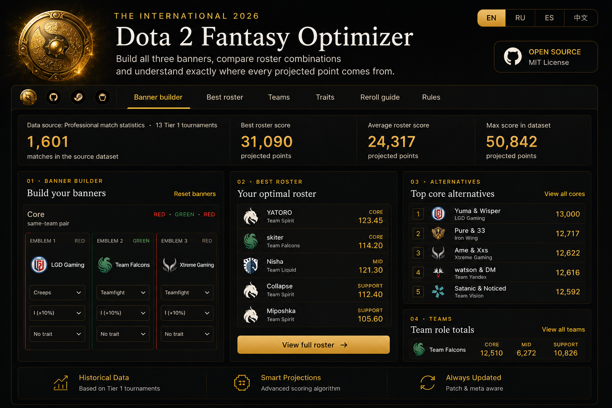

<div align="center">

# 🛡️ TI2026 Fantasy Calculator & Optimizer

Build five-emblem Fantasy banners, compare active Main Event players, evaluate trainer titles and create a complete TI2026 playoff prediction.

[](https://vlad-kononov-portfolio.duskyskink6.chatgpt.site/#/projects/ti2026)
[](https://github.com/Kadadji1/dota2-fantasy-optimizer-2026/stargazers)

**English · Русский · Español · 简体中文 · Desktop / Mobile**

</div>

<p align="center">
  
</p>

## Completed event project

The live website has been closed after the tournament decision window. This repository preserves the source and documentation; it does not provide a currently hosted calculator.

[Project case study](https://vlad-kononov-portfolio.duskyskink6.chatgpt.site/#/projects/ti2026) · [Analytics evidence](docs/analytics-evidence.md) · [Production QA case](docs/qa/bracket-routing.md)

## Results from the live period

| Metric | Result | Source / reporting window |
| --- | --- | --- |
| Visitors | **94,508** | Vercel Analytics / Last 30 Days |
| Page views | **247,239** | Vercel Analytics / Last 30 Days |
| Organic search clicks | **approximately 31K** | Google Search Console / 28 days |
| Search impressions | **approximately 305K** | Google Search Console / 28 days |

These are historical snapshots, not current counters. The screenshots show relative reporting windows; exact start/end dates are not fully visible. Clicks are not unique visitors, and impressions are not page views. [View the original evidence](docs/analytics-evidence.md).

## Product ownership

I owned product scope, implementation/integration, testing, debugging, deployment, tournament-data updates, analytics review, and community support. Cursor and ChatGPT assisted development; I remained responsible for reviewing and validating behavior.

The final live version followed the **TI2026 Main Event**. Group Stage results were used as historical tournament context.

## Main sections

- **Fantasy Calculator** — enter the five emblems on each banner, select a shared Prefix and Suffix, then compare the strongest Core, Mid and Support choices.
- **Main Event Predictions** — fill the complete 14-match double-elimination bracket, compare two models and see expected Compendium prediction points.
- **Fantasy Guide** — learn how scoring, tiers, traits, trainer titles, team opportunity, rerolls and saving work.

## Final live-version scope

The final event snapshot included the eight remaining teams in Fantasy rankings and team-opportunity cards:

- TEAM VISION
- Nigma Galaxy
- Team Liquid
- Iron Wing
- Team Falcons
- Team Spirit
- Team Yandex
- BoomBoys

Eliminated teams remain only in historical source data and are not selectable or ranked by the current calculator.

## Fantasy Calculator

### Banner and roster support

- five emblem slots for each Main Event banner;
- one Core pair, one Mid player and one Support pair;
- role-compatible red, blue and green stats;
- tiers I–V: **+10%, +30%, +60%, +100%, +150%**;
- Fractal, Benevolent, Vampiric, Unique and Friendly trait interactions;
- player-specific contribution breakdowns and alternatives;
- automatic local saving of emblems, Prefix and Suffix.

Core and Support entries represent a same-team pair. Mid entries represent one player. Player projections are **per match**; team title chance and expected remaining maps are shown separately and do not silently change the player ranking.

### Trainer titles

The calculator supports one shared Prefix and one shared Suffix for the roster.

- Prefix expected value uses the player's historical hero-group trigger rate and the title bonus.
- Pair trigger rates use the simple average of both players.
- The TI draft-context block summarizes **109 Group Stage maps**.
- Suffixes are displayed as conditional scenarios because their triggering events occur on future individual maps.

### Team opportunity

Each active team card shows:

- model title chance;
- expected maps remaining;
- chance to play at least 2, 3 or 4 Main Event series.

These values describe tournament opportunity, not guaranteed Fantasy points.

## Main Event Predictions

The prediction page contains the complete eight-team double-elimination bracket:

- 14 selectable matches from the upper quarterfinals through the Grand Final;
- confirmed opening matchups;
- a compact one-line schedule in New York time;
- **Balanced** and **TI-only** models;
- downstream opponents rebuilt from every selected winner;
- match win probabilities;
- 20,000 deterministic bracket simulations per selection state;
- expected correct picks and expected Compendium points;
- team placement probabilities and expected maps.

The official prediction reward scale depends on the **total number of correct picks**, from 120 points for one correct result to 12,000 points for all 14.

Model probabilities are estimates based on relative team strength. They are not bookmaker odds or guarantees.

## Data and methodology

- dedicated Fantasy player sample: **1,601 matches across 13 Tier 1 tournaments**;
- broader project analysis: **8,000+ professional matches across 80+ events**;
- bracket projection: **20,000 simulations**;
- current TI context: Group Stage records, map results and 109-map draft summary.

Each game is scored separately. A series result uses its two highest-scoring games, and the displayed player or pair value is an average match score over the source tournaments.

Known limitations are stated in the interface and Guide:

- Lotus events are approximate because public match data does not expose the exact pickup event reliably;
- two rare Suffix conditions cannot be modeled reliably from OpenDota events;
- Prefixes use historical trigger frequencies;
- Suffix results are conditional examples;
- team probabilities are model estimates and may change with new information.

## Localization and responsive design

The calculator, predictions, guide, roster section and navigation support:

- English;
- Russian;
- Spanish;
- Simplified Chinese.

Desktop uses full tables and bracket columns. Mobile uses round-by-round bracket navigation, compact team-probability cards, horizontally scrollable utility rows and single-column Guide/roster layouts.

## Historical tournament dates

- **Group Stage:** August 13–16, 2026 — completed;
- **Main Event:** August 20–23, 2026, Shanghai.

During the live event, Main Event Fantasy needed to be locked before the first match. The website presents match times in New York time where a timezone is needed.

## Technology

- Next.js 14
- React 18
- TypeScript
- Vercel Analytics
- Vercel hosting

## Local development

```bash
npm install
npm run dev
```

Open `http://localhost:3000`.

Production verification:

```bash
npm run build
```

## Quality checks

The calculator has automated checks for the scoring logic and the core browser flow.

```bash
# Fast unit tests for score calculation, traits and role ranking
npm test

# Browser checks for loading the calculator, changing a selection and saving it
npx playwright install chromium
npm run test:e2e

# Run both suites
npm run test:all
```

The unit suite protects the calculation rules in `lib/optimizer.ts`. The browser suite covers the public calculator experience, including a saved title selection after a page reload. GitHub Actions runs both suites for every push and pull request.

## Project status

- [x] Five-emblem Main Event Fantasy calculator
- [x] Active-team-only player rankings
- [x] Traits, tiers, Prefixes and Suffix scenarios
- [x] Team title chance, expected maps and series thresholds
- [x] Complete interactive Main Event bracket
- [x] Official 14-pick point scale
- [x] English, Russian, Spanish and Simplified Chinese
- [x] Responsive desktop and mobile layouts
- [x] Persistent browser-local calculator setup
- [x] Main Event Fantasy Guide
- [x] Live event completed; hosted website closed
- [x] Source, analytics evidence, and production QA case retained
- [ ] A future tournament edition is not currently committed

## Support the project

- [⭐ Star this repository](https://github.com/Kadadji1/dota2-fantasy-optimizer-2026)
- [❤️ Support the project](https://buymeacoffee.com/kadadji?status=1)
- [🎮 Steam profile](https://steamcommunity.com/id/Kadadji1/)

## Disclaimer

This is an independent fan-made community project and is not affiliated with Valve Corporation.

Dota 2, The International and all related trademarks and assets belong to their respective owners.
