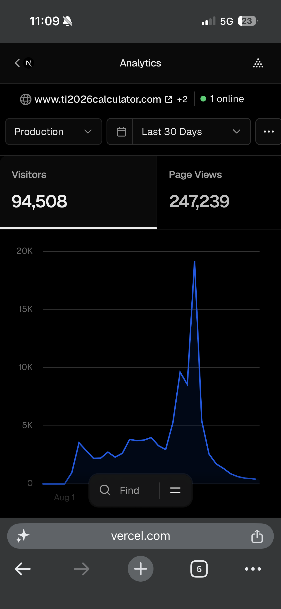
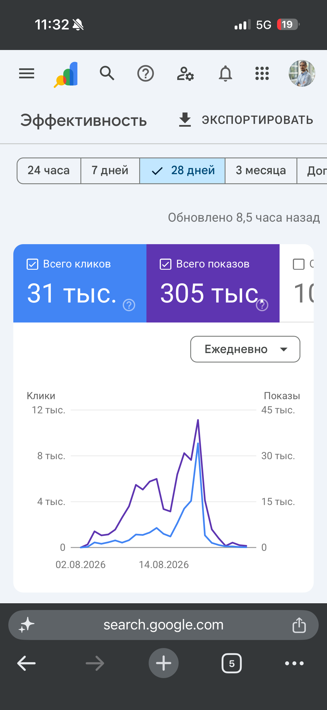

# TI2026 analytics evidence

Original screenshots supplied by the project owner during the live-product review. The website is now closed. These are historical snapshots, not live counters.

| Source | Visible window | Metric |
| --- | --- | --- |
| Vercel Analytics | Last 30 Days | 94,508 visitors; 247,239 page views |
| Google Search Console | 28 days | Approximately 31K clicks; approximately 305K impressions |

The exact start/end dates are not fully shown. Do not infer precise date ranges from upload dates. Google rounds the displayed totals; 31K and 305K should not be presented as exact counts. The screenshot interface is in Russian: “Всего кликов” means total clicks and “Всего показов” means total impressions.

## Vercel Analytics

## Google Search Console

## Interpretation

Visitors, page views, organic search clicks, and search impressions measure different things. Do not add them together or call them all users. Personal Fantasy account percentiles are a separate outcome, not algorithm prediction accuracy.
